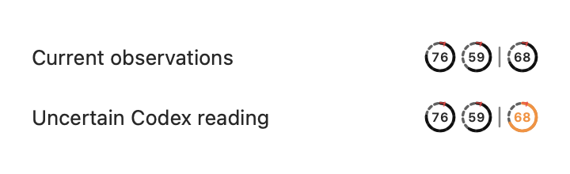
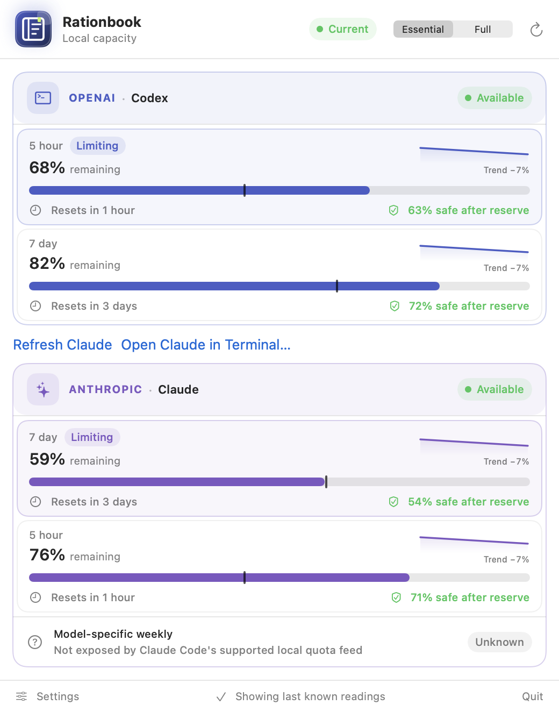
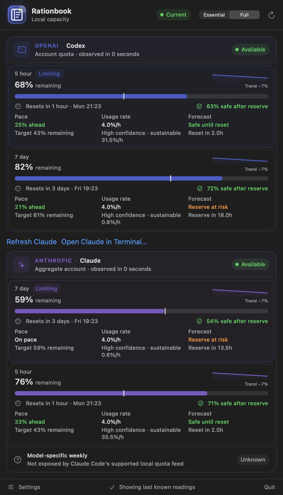

# Rationbook

An **Attomus Labs** project: Codex and Claude capacity in your macOS menu bar, with local history, reserve warnings and a CLI for automation.

**0.1.2 · Apple Silicon · macOS 14+.** Official downloads are signed by Attomus Limited and notarised by Apple.



## Install

[Download Rationbook](https://github.com/attomus/rationbook/releases/download/v0.1.2/Rationbook-0.1.2.zip), extract it and move Rationbook.app to Applications. The [release page](https://github.com/attomus/rationbook/releases/tag/v0.1.2) includes its SHA-256 checksum.

```sh
# Menu-bar app
brew install --cask attomus/tap/rationbook
# CLI and feed helper only
brew install --formula attomus/tap/rationbook
```

Both packages use the same signed archive. Background refresh requires the running app. If you install the formula, skip the app’s **Install Rationbook CLI** action to avoid competing commands in your PATH.

## Get started

Install and sign in to Codex and/or Claude Code using their own tools. Either provider works independently. Prefer the vendor installer or Homebrew: version-manager paths can be refused when their permissions fail the [executable checks](SECURITY.md).

1. Open Rationbook and refresh to read Codex capacity.
2. In Settings, enable **Claude Code quota feed**, then choose **Refresh Claude**. Choose your automatic refresh interval there, or select Manual.
3. If Claude needs interaction, choose **Open Claude in Terminal…**. Once usage appears, press **Esc**, type `/exit`, then return to Rationbook.

Claude refresh runs the built-in `/usage` account-limit check without sending a model prompt or generating a model response. Claude Code can still incur background token usage; this is not a zero-token guarantee. See [provider behaviour, refresh timing and terms](docs/PROVIDERS.md).

## Reading capacity

The rings show Claude’s short and weekly windows, then Codex’s limiting window. The panel adds reset times, trends, reserves and forecasts. Old readings retain their last-known values with uncertainty shown; retired windows appear under **Previous readings**. Claude’s aggregate feed does not expose model-specific allowances. Forecasts are estimates, not guarantees that a task will fit.

| Essential · Light | Full · Dark |
| --- | --- |
|  |  |

[Settings screenshot](docs/screenshots/rationbook-settings-dark.png). Images use synthetic data rendered from the app’s UI; see [screenshot maintenance](docs/screenshots/README.md).

## CLI and source

```sh
rationbook status --json
rationbook history --json --limit 100
rationbook forecast
```

See the [JSON contract](docs/API.md). To build locally, use Xcode 26 / Swift 6.2:

```sh
git clone https://github.com/attomus/rationbook.git
cd rationbook
scripts/package-app.sh
open dist/Rationbook.app
```

Source builds use development signatures. Intel Macs are not supported. Move the app to Applications before enabling Open at Login. Updates are manual; after upgrading, re-enable the Claude feed to update its copied helper.

## Project

Attomus Labs shares practical tools from our engineering work. Use, inspect, adapt or contribute to Rationbook. There is no Rationbook account or telemetry; see [privacy and removal](PRIVACY.md), [security](SECURITY.md), [architecture](docs/ARCHITECTURE.md), [contributing](CONTRIBUTING.md) and [releasing](docs/RELEASING.md).

Apache-2.0: [licence](LICENSE) and [notices](NOTICE.md).
